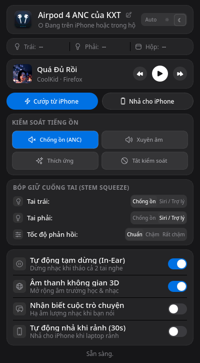
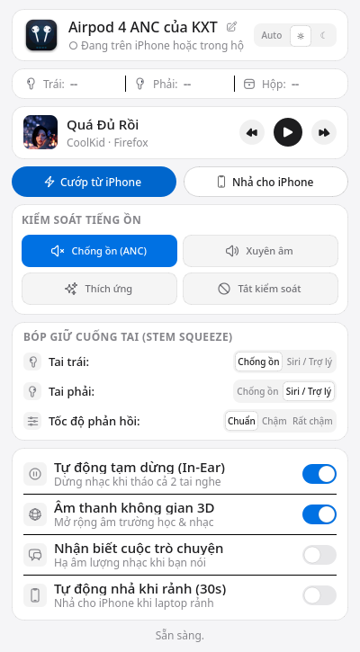

# PodHop — Apple AirPods Manager for Linux

[](https://archlinux.org/)

**PodHop** mang lại trải nghiệm sử dụng Apple AirPods mượt mà, tiện lợi và tiết kiệm tài nguyên nhất trên Linux. Dự án kết hợp một daemon nền siêu nhẹ tối ưu sâu ở tầng giao thức phần cứng Bluetooth L2CAP (**Apple Accessory Protocol - AAP**) và giao diện người dùng đồ họa hiện đại, trực quan, sắc nét.

---

## Giao diện ứng dụng

| Giao diện Tối (Dark Mode) | Giao diện Sáng (Light Mode) |
|:---:|:---:|
|  |  |

---

## Bảng đo đạc tài nguyên thực tế (RAM & CPU)

Hệ thống được tối ưu hóa sâu ở tầng C/Glibc và Qt Event Loop, loại bỏ hoàn toàn polling loop thừa và bộ nhớ rác. Dưới đây là số liệu đo đạc thực tế trên Arch Linux / CachyOS (KDE Plasma 6 Wayland, Kernel 6.11):

| Thành phần | VmRSS (Bộ nhớ thực tế) | Bộ nhớ riêng biệt (RssAnon) | Systemd CGroup Peak | Mức chiếm CPU |
| :--- | :---: | :---: | :---: | :---: |
| **Daemon chạy ngầm** (`podhop-daemon`) | **16.2 MB** | **8.1 MB** | **10.7 MB – 12.9 MB** | **< 0.05%** |
| **Giao diện khi hiển thị** (`airpods`) | **117.4 MB** *(gồm lib Qt6)* | **35.4 MB** | — | **0.0%** |
| **Giao diện khi ẩn chạy ngầm** (Dormant) | **80.6 MB** | **28.2 MB** | — | **0.000%** |
| **So với các app Electron / Web** | ~350 MB – 550 MB | ~280 MB – 400 MB | ~450 MB | ~1.5% – 4% |

### Các kỹ thuật tối ưu hóa RAM chuyên sâu:
1. **Glibc Heap Memory Trimming (`malloc_trim` & `mallopt`)**:
   * Thiết lập `mallopt(M_TRIM_THRESHOLD, 64KB)` để yêu cầu allocator trả ngay các khối nhớ giải phóng về cho Linux Kernel thông qua `brk`/`madvise(MADV_DONTNEED)`, tránh hiện tượng găm giữ bộ nhớ ảo của CPython.
   * Tự động kích hoạt `malloc_trim(0)` định kỳ và sau mỗi lần cửa sổ chuyển trạng thái ẩn.
2. **Cơ chế ngủ đông khi ẩn giao diện (Dormant on Hide)**:
   * Khi đóng cửa sổ hoặc click ra ngoài, `QTimer` refresh (1.5s) được ngắt hoàn toàn (`timer.stop()`), triệt tiêu 100% CPU và ngăn chặn cấp phát chuỗi/dict định kỳ.
   * Khi mở lại app, cửa sổ kích hoạt `showEvent`, lập tức đồng bộ trạng thái mới nhất rồi mới khởi động lại timer.
3. **Bộ đệm Icon Vector SVG (`_PIXMAP_CACHE`)**:
   * Cache các icon đã render vào bộ nhớ đệm `(name, color, size, dpr)`, loại bỏ thao tác đọc ổ đĩa, phân tích cú pháp XML SVG và tạo `QPainter` liên tục.
4. **Đường ống trích xuất Media một lệnh duy nhất (Single-Call Pipeline)**:
   * Gom toàn bộ 5 lệnh `playerctl` và `busctl` trước đây thành duy nhất 1 lệnh trích xuất:  
     `playerctl metadata --format '{{status}}:::{{playerName}}:::{{title}}:::{{artist}}:::{{mpris:artUrl}}'`  
   * Giảm hơn 80% chi phí tạo tiến trình con (fork/exec churn).
5. **Bộ đệm ảnh bìa Album (Album Art Caching)**:
   * Chỉ nạp và bo góc ảnh thumbnail khi bài hát thực sự thay đổi, tránh nạp lại file ảnh vào RAM hàng trăm lần mỗi bài hát.
6. **Systemd CGroup Limits & Bytecode Optimization**:
   * Daemon chạy với cờ `PYTHONOPTIMIZE=2` tước bỏ toàn bộ docstrings và assertion trong bytecode.
   * Cấu hình giới hạn bộ nhớ chặt chẽ: `MemoryHigh=20M`, `MemoryMax=35M`.

---

## Tính năng nổi bật

### 1. Kiểm soát tiếng ồn 4 chế độ (Active Noise Control)
* Chuyển đổi tức thì 4 chế độ qua giao thức Apple AAP phần cứng:
  * **Chống ồn chủ động (ANC)**: Triệt tiêu tạp âm môi trường tối đa.
  * **Xuyên âm (Transparency)**: Nghe âm thanh môi trường tự nhiên như không đeo tai nghe.
  * **Thích ứng (Adaptive Audio)**: Tự động cân bằng giữa Chống ồn và Xuyên âm theo âm lượng xung quanh.
  * **Tắt kiểm soát (Off)**: Tắt toàn bộ để tiết kiệm pin.
* **Thanh tinh chỉnh mức Thích ứng**: Tùy biến mức độ thích ứng (*Nhiều ồn / Cân bằng / Ít ồn*) với nút điều khiển trực quan.

### 2. Tự động phát hiện đeo tai nghe (In-Ear Detection)
* Phản hồi ngắt/tiếp tục nhạc thời gian thực (**< 0.3 giây**):
  * **Chế độ chuẩn (Mặc định)**: Tháo 1 tai **nhạc vẫn phát bình thường**, chỉ khi **tháo cả 2 tai nhạc mới tự động ngắt** (`pause_on_ear: both`).
  * **Bảo vệ 2 lớp chống phát nhầm (Hard Mute & 2-Ear Resume)**: Khi tháo cả 2 tai ra để trên bàn hoặc cầm trên tay, daemon tự động khóa âm lượng phần cứng tai nghe (`pactl set-sink-mute`). Ngăn chặn 100% hiện tượng cảm biến da quang học bị chạm gây phát nhạc nhầm trên bàn. Hệ thống chỉ tự động mở tiếng và phát tiếp khi bạn **đeo lại đủ cả 2 tai**.
  * Tự động điều khiển dứt khoát mọi trình phát nhạc (*Firefox, Spotify, Chrome, VLC...*) qua `playerctl pause -a`.

### 3. Báo mức pin 3 thành phần & Ghi nhớ thông minh (Smart Caching)
* Hiển thị chi tiết % pin độc lập: **Tai Trái (L)**, **Tai Phải (R)** và **Hộp sạc (Case)** kèm biểu tượng sạc.
* **Cơ chế Smart Caching**:
  * Khi mở nắp hộp: Cập nhật ngay % pin thực tế của hộp.
  * Khi đóng nắp hộp: Hộp sạc AirPods tự động ngủ sâu ngắt sóng; app sẽ thông minh lưu lại mức pin gần nhất (`~XX%`) thay vì xóa trắng.
* **Cảnh báo pin yếu trên Desktop**: Tự động gửi thông báo Native Notification khi pin tai nghe chạm ngưỡng **20%**, **10%**, **5%** và cảnh báo khi cạn pin ngắt nguồn.

### 4. Tự động chuyển đổi & Nhả tai nghe (Auto Switch & Auto Release)
* **Tự động chuyển tai nghe từ iPhone sang Linux**: Khi máy tính bắt đầu phát âm thanh (YouTube, Spotify...), daemon kích hoạt L2CAP channel để kéo AirPods từ iPhone về máy tính trong **1.4s – 3s**.
* **Tự động nhả tai nghe về iPhone (Auto Release)**: Khi máy tính ngừng phát âm thanh trong 30 giây, daemon tự động giải phóng kết nối để iPhone có thể lập tức phát nhạc/nghe cuộc gọi mà không bị máy tính chiếm giữ.

### 5. Nhận biết cuộc trò chuyện & Âm thanh không gian
* **Nhận biết cuộc trò chuyện (Conversational Awareness)**: Giao thức Apple AAP phần cứng tự động phát hiện khi bạn bắt đầu cất tiếng nói, tự động hạ âm lượng nhạc và tăng âm thanh xung quanh để bạn trò chuyện trực tiếp mà không cần tháo tai nghe.
* **Âm thanh không gian (Spatial Audio)**: Kích hoạt chế độ mở rộng âm trường trên AirPods mang lại trải nghiệm xem phim, nghe nhạc và học tập sống động.

### 6. Widget Trình phát nhạc toàn hệ thống (Now Playing Media Player)
* Tích hợp chuẩn **MPRIS D-Bus & playerctl**:
  * Điều khiển **Play / Pause / Next / Previous** mượt mà cho mọi ứng dụng đa phương tiện trên Linux.
  * Hiển thị ảnh bìa Album thực tế (Album Art) bo góc, tự động trích xuất thông tin Bài hát và Nghệ sĩ.

### 7. Giao diện sắc nét & Tối ưu HiDPI Retina
* Bố cục lưới điều khiển 2x2 to rõ, trực quan và dễ thao tác nhanh.
* Bộ biểu tượng **Heroicons Vector SVG** sắc nét 100% trên các màn hình độ phân giải cao Retina / HiDPI (**DPR 1.5x, 2.0x, 2.5x**).
* Tự động đồng bộ giao diện Sáng / Tối theo hệ điều hành, hoặc chuyển đổi thủ công chỉ với 1 click.
* **Cơ chế Single-Instance**: Click ra ngoài sẽ đóng cửa sổ về nền, khi mở lại app hiện lên tức thì trong 1 mili-giây mà không tạo nhiều tiến trình trùng lặp. Không hiển thị icon khay hệ thống (tray icon) gây rối thanh Taskbar.

---

## Cấu trúc thư mục

```text
podhop/
├── bin/
│   ├── podhop-daemon        # Daemon nền quản lý âm thanh, In-Ear & Bluetooth AAP
│   └── airpods              # Giao diện người dùng đồ họa PySide6 / Qt6
├── systemd/
│   └── podhop.service       # Cấu hình Systemd User Service tự khởi động cùng máy
├── desktop/
│   └── airpods.desktop      # XDG Desktop Shortcut cho App Launcher (KDE, GNOME...)
├── icons/                   # Bộ icon SVG vector và App icon 512x512
│   ├── airpods.svg / .png
│   ├── airpod-left.svg
│   ├── airpod-right.svg
│   ├── airpod-case.svg
│   └── ... (các icon chức năng)
├── screenshots/             # Ảnh chụp giao diện thực tế
│   ├── dark_mode.png
│   └── light_mode.png
├── install.sh               # Kịch bản cài đặt tự động 1-click
├── uninstall.sh             # Kịch bản gỡ cài đặt sạch sẽ
├── requirements.txt         # Thư viện Python phụ thuộc
└── README.md                # Tài liệu hướng dẫn
```

---

## Hướng dẫn cài đặt

### 1. Cài đặt các gói phụ thuộc hệ thống
* **Arch Linux / CachyOS / Manjaro**:
  ```bash
  sudo pacman -S --needed python python-pyside6 playerctl libnotify pipewire bluez bluez-utils
  ```
* **Ubuntu / Debian**:
  ```bash
  sudo apt install -y python3 python3-pyside6 playerctl libnotify-bin pulseaudio-utils bluez
  ```
* **Fedora**:
  ```bash
  sudo dnf install -y python3 python3-pyside6 playerctl libnotify pipewire-utils bluez
  ```

### 2. Chạy cài đặt tự động
Clone repository và chạy script cài đặt:
```bash
cd podhop
chmod +x install.sh uninstall.sh
sudo ./install.sh
```

Sau khi cài đặt xong:
* Khởi chạy ứng dụng bằng cách gõ lệnh: `airpods`
* Hoặc tìm **AirPods 4 ANC Manager** trong App Launcher của hệ điều hành.
* Tiến trình nền `podhop.service` sẽ tự động khởi chạy và quản lý tai nghe.

### 3. Gỡ cài đặt
Nếu muốn gỡ sạch ứng dụng:
```bash
sudo ./uninstall.sh
```

---

## Cấu hình tùy chỉnh (`~/.config/podhop.json`)

File cấu hình được tự động tạo và lưu tại `~/.config/podhop.json`:
```json
{
  "addr": "70:AE:2A:59:B8:8C",
  "name": "Airpod 4 ANC của KXT",
  "auto_switch_on_playback": true,
  "disconnect_on_idle": false,
  "idle_timeout_seconds": 30,
  "cooldown_after_remote_switch": 45,
  "default_mode": "anc",
  "in_ear_detection": true,
  "pause_on_ear": "both",
  "adaptive_strength": 50,
  "adaptive_volume": true,
  "spatial_enabled": true,
  "theme": "system"
}
```

---

## Nguồn tham khảo & Lời cảm ơn

Dự án được xây dựng và phát triển mở rộng dựa trên ý tưởng và mã nguồn ban đầu của tác giả [Mur5h/PodHop](https://github.com/Mur5h/PodHop) về giao thức chuyển đổi tai nghe AirPods trên Linux qua Bluetooth L2CAP (Apple Accessory Protocol - AAP).
